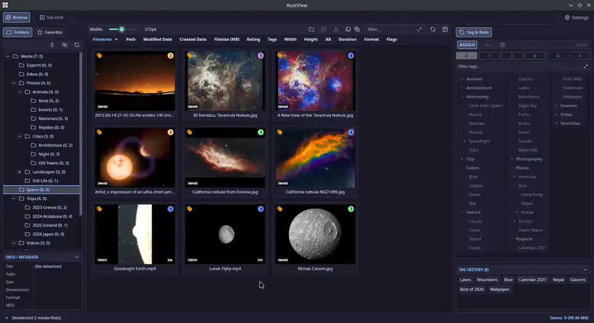
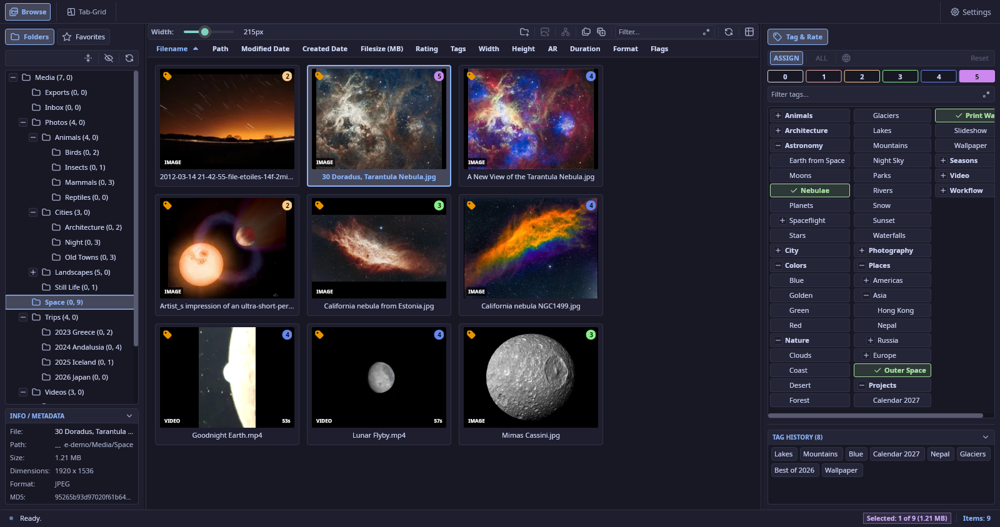
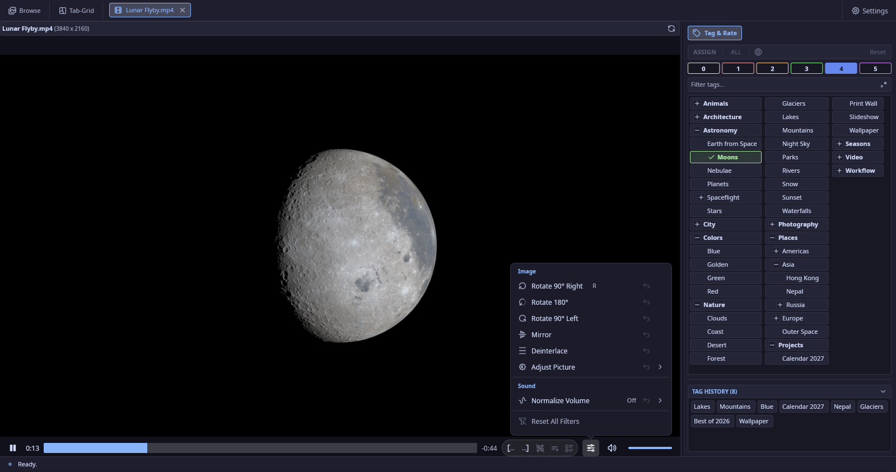
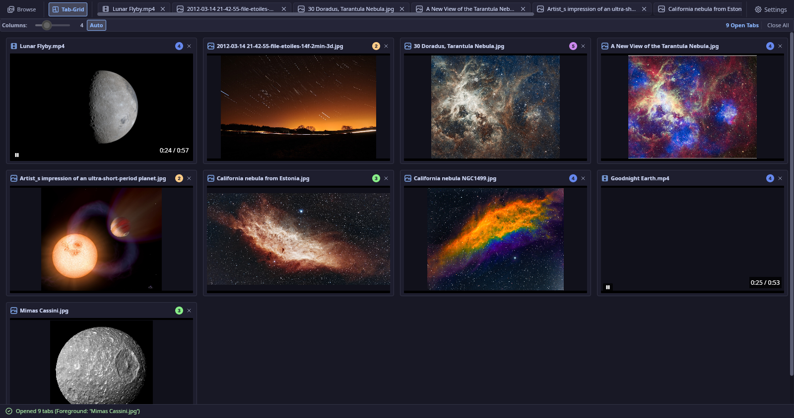

# RustView

[](LICENSE)
[](https://github.com/vommie/rustview/releases)


A fast media browser for images and videos on Linux. RustView keeps its own library of your folders, tags and ratings, scrolls
through very large collections without stutter and never touches the drive unless you ask for a refresh. It is written in Rust with a
Slint user interface; videos play through the embedded mpv player and most formats are decoded by FFmpeg.





## Quick start

1. Install the package (see [Install](#install)) and start RustView from the application menu.
2. Choose your media folder as the root folder in Settings > General.
3. Click **Refresh > Refresh Entire Tree (Full)** in the Folders toolbar once; RustView reads the drive only when you ask it to.
4. Pick a folder, select media and tag and rate them in the **Tag & Rate** panel (switch it to **ASSIGN**), or open them with a
   double click, `Enter` (tabs) or `F11` (Multiview).

## RustView and RustCut

[RustCut](https://github.com/vommie/rustcut) is the video cutter that belongs to RustView. It cuts, filters and renders clips and tags
and rates them in the same RustView library through RustView's command line API (`rustview api`), so a rendered clip shows up in
RustView with its tags and rating; the clips RustView already knows are recognized by their hash.

## Features

- **Browse** your folders as a thumbnail grid or a sortable table with a resizable column bar. Thumbnails carry badges for the rating, tags,
  media type and video duration; hovering a video or an animated picture plays a short preview. Rubber band selection, keyboard
  navigation and type-ahead find (just start typing a name) work in both views.
- **Folder tree and favorites** with hidden-folder handling, drag and drop of files onto folders, New Folder, rename, move and delete
  dialogs that explain exactly what happens on disk and in the library, and a history (`Alt+Left/Right`).
- **Tags and ratings:** a hierarchical tag tree, a tag history, ratings from 1 to 5 and queries by tag and rating. **Ctrl+0** (no rating) to **Ctrl+5** rate the selection, and in a Multiview every medium that is shown, with a short animation of the new rating.
- **Multiview:** up to four images or videos side by side in a fullscreen, or as a tab. Tiles follow your selection, can be pinned
  ("sticky"), swapped, duplicated and resized with gutters; every tile has a media action bar and **zoom** for images (slider, `Ctrl` + wheel,
  minimap).
- **Crop pictures** in the Multiview: a modern crop tool with live pixel size, aspect-ratio presets (left click landscape, right click portrait, O = original,
  Shift keeps the ratio) that works at every zoom; Undo/Redo, and Save that keeps quality (lossless JPEG crops on the block grid, the file's own quality
  otherwise, lossless formats stay lossless, EXIF/ICC/XMP kept) and never damages the original (written completely and checked first, conflicts are asked
  about). Save As exports to JPEG, PNG, WebP, AVIF, TIFF or BMP with their options; formats RustView only reads are saved that way.
- **Tabs and tab grid:** open media in tabs and see them all in a masonry grid; a lone medium fills the whole tab. Select tabs with Ctrl/Shift+click
  and **merge** them into one Multiview tab (videos keep playing), or merge a tab with its neighbors from its menu.
- **Formats:** 47 image and video formats (JPEG, PNG, WebP, AVIF, HEIC, TIFF, GIF, SVG, EXR, MP4, MKV, WebM, raw H.264/HEVC, ... see
  [docs/file_formats.md](docs/file_formats.md)), each switchable in the settings; the content, not the extension, decides what is an image
  or a video.
- **File operations:** copy, move, rename and delete (to the trash or permanently) with conflict handling, cut/copy/paste through the system
  clipboard and drag and drop to other applications.
- **Fast by design:** a ring pool of tiles keeps scrolling O(visible rows), records take about 300 bytes, large lists are loaded on a worker thread and a
  RAM budget bounds the thumbnail cache ([measurements](docs/perf/RESULTS.md)).
- **Private by design:** optional log obfuscation hides file names, paths and tag names in the log output.
- **Scriptable:** a headless command line API reads and writes ratings, tags and hashes for other tools, and a migration tool imports an
  XnView MP database.
- **Everything persists:** window state, sidebar widths, collapsed panels, the open folder, filters and selections.

| | |
| --- | --- |
|  |  |



## Platform

RustView targets **Arch Linux and Manjaro with KDE Plasma**. In an X11 session RustView runs on X11. In a Wayland session it runs as a
native Wayland program: videos and everything over them work there too (they are drawn by the app itself), only a few X11 features are
missing for now (dragging files to other programs, dialogs tied to their window, the pointer lock of the minimap drag). Start it with
`RUSTVIEW_WINDOW_SYSTEM=x11` to run it through XWayland (part of KDE Plasma), where those work. Other distributions and desktops are not a target.

## Install

**Download the newest release** (Arch Linux, Manjaro) with the [GitHub CLI](https://cli.github.com/) (`sudo pacman -S github-cli`) or from the
Releases page. The [Releases page](https://github.com/vommie/rustview/releases)
lists every version with its changelog:

```bash
gh release download --repo vommie/rustview --pattern 'rustview-x86_64.pkg.tar.zst' --pattern SHA256SUMS
sha256sum -c SHA256SUMS --ignore-missing
sudo pacman -U rustview-x86_64.pkg.tar.zst
```

The package needs `ffmpeg` and `mpv` (both are installed as dependencies).

### Build from source

```bash
sudo pacman -S --needed rustup base-devel git clang pkgconf ffmpeg mpv
git clone git@github.com:vommie/rustview.git && cd rustview
cargo build --release            # a cold build takes about 10 minutes
./build-package.sh               # optional: builds dist/rustview-<version>-1-x86_64.pkg.tar.zst
```

Your library lives in `~/.local/share/rustview`, the settings in `~/.config/rustview/settings.json`. A new version always reads the
library and the settings of an older one; a schema change that old data cannot survive is not accepted.

## Command line

```bash
rustview api tag-tree --json
rustview api get-media --path /media/clip.mp4 --json
rustview api set-media --path /media/clip.mp4 --rating 5 --tags 1,4,7 --source MyTool --json
rustview api check-hashes --hashes-file hashes.txt --json
rustview api move-media --from /out/clip.mkv --to /videos/clip.mkv --json   # the record follows a moved file
rustview --migrate-xnview ~/.config/xnviewmp/XnView.db --yes      # import an XnView MP database
rustview api --help
```

## Limitations

- Arch Linux and Manjaro with KDE Plasma only; other distributions and desktops are not tested.
- Wayland lacks a few X11 features (see [Platform](#platform)).
- No light theme yet; the app uses one dark palette.

## Contributing

Bug reports and ideas are welcome as [issues](https://github.com/vommie/rustview/issues) and in the
[discussions](https://github.com/vommie/rustview/discussions). The repository does not take pull requests. [AGENTS.md](AGENTS.md)
holds the rules for contributors and coding agents (stack, licenses, icons, code style, checks). Cargo aliases: `cargo ck` (check),
`cargo cl` (clippy), `cargo t` (tests), `cargo br` (release build). The changes of every version are in [CHANGELOG.md](CHANGELOG.md).

## Security

Please report security problems privately, as described in [SECURITY.md](SECURITY.md).

## License

RustView's own source code is released under the [MIT License](LICENSE).

The built program as a whole is under the GPL-3.0: it links the system's libmpv and FFmpeg libraries, which are usually built under the
GPL (Arch and Manjaro do), and it uses Slint under its GPL-3.0 option. [ATTRIBUTION.md](ATTRIBUTION.md) and `LICENSES/` hold the notices
the licenses require; the package installs them to `/usr/share/licenses/rustview/`.

### Built with

- **[Slint](https://slint.dev)** by SixtyFPS GmbH, used under the GPL-3.0. RustView is made with Slint (<https://slint.dev>).
- [mpv](https://mpv.io) (libmpv) for video playback and [FFmpeg](https://ffmpeg.org) for decoding.
- [Tabler Icons](https://tabler.io/icons) (MIT) for the interface icons; the app icon is built from two of them (the grid and the eye).
- [LMDB](https://www.symas.com/lmdb) through [heed](https://github.com/meilisearch/heed), [image](https://github.com/image-rs/image),
  [resvg](https://github.com/linebender/resvg) and many more crates (see `Cargo.lock`).
- The pictures and videos in the screenshots are public domain or CC BY works from Wikimedia Commons and NASA; authors and
  licenses are listed in [docs/screenshots/CREDITS.md](docs/screenshots/CREDITS.md).
